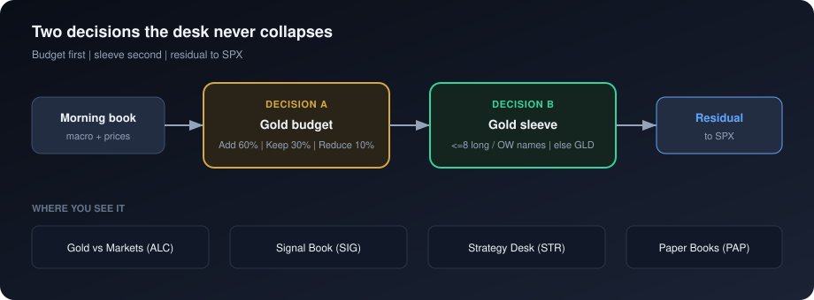
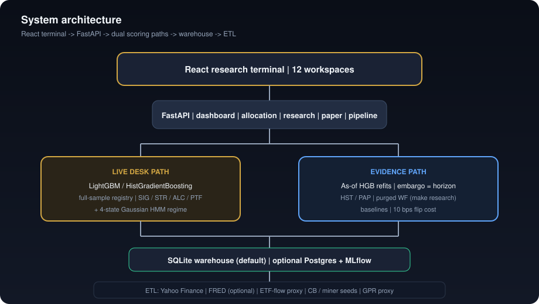
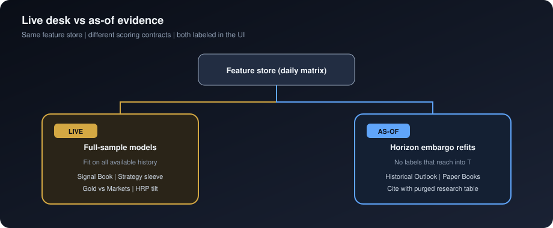
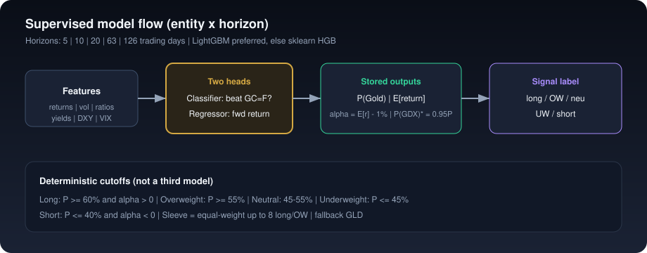
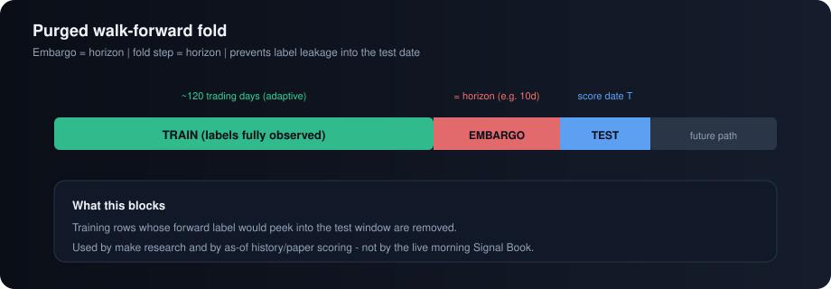
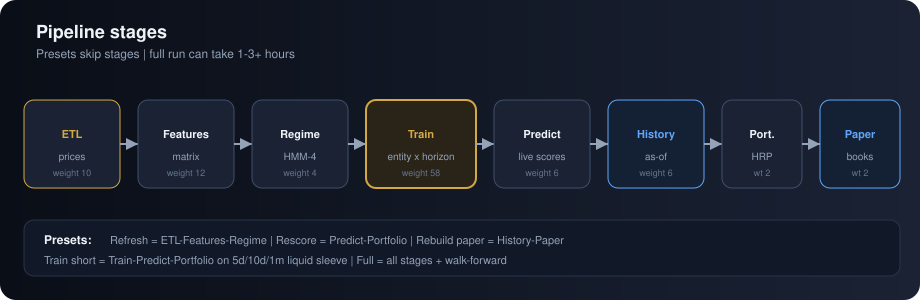

# PMIP — Technical walkthrough for data science peers

**Audience:** classmates and faculty in a Master’s of Data Science program  
**Product:** Precious Metals Macro Intelligence Platform (PMIP)  
**Goal of this note:** explain what was built, which models produce which numbers, how evaluation avoids look-ahead, and what is still a rule or a seed rather than a learned probability.

Related reading: [Research note](research-note.md) (citeable purged study), [PRD](PRD.md), [README](../README.md).

---

## 1. What problem this solves

A gold allocation book faces **two different decisions**:

1. **Gold budget** — Over the next few weeks, should gold exposure be larger or smaller versus equities (and the rest of a multi-asset book)?
2. **Gold sleeve** — Given that budget, how should it be split between bullion (e.g. GLD / futures) and miners / royalties?



Most “AI for gold” demos collapse those into one score. PMIP keeps them separate, then adds an **evidence layer** (purged walk-forward + multi-horizon paper books) so you can tell classmates *what is allowed to mean what*.

It is a **local research desk**, not a trading system. It does not place orders.

---

## 2. System architecture (one picture)



| Layer | Choice |
| --- | --- |
| API | FastAPI + uvicorn |
| UI | React 18 + TypeScript + Vite + Recharts |
| Store | SQLite `data/pmip.db` (default); optional Postgres |
| ML | LightGBM when available; else sklearn `HistGradientBoosting` |
| Regime | `hmmlearn` Gaussian HMM (4 states) |
| Portfolio | Hierarchical risk parity (`riskfolio`) + prediction tilt |
| ETL | `yfinance`, optional `fredapi` |

Run locally: `make install` → `make init-db` → pipeline (UI or `make pipeline`) → `make dev` → http://localhost:8000.

---

## 3. The claim that matters most: live vs as-of



| Path | Who uses it | How the model is fit | Version tag |
| --- | --- | --- | --- |
| **Live / full-sample** | Signal Book, Strategy sleeve, Gold vs Markets gold forecast, HRP expected-return tilt | Classifier + regressor trained on all available aligned history for that entity × horizon | `lgbm_h*` or `sklearn_h*` |
| **As-of / embargo** | Historical Outlook charts, Paper Books | At each score date *T*, refit using only rows whose forward labels are fully observed by *T* (train ends at least `horizon` trading days before *T*) | `asof_h{horizon}` |

UI badges: **live** vs **as-of**. API field: `scoring_path` ∈ `{full_sample_live, asof_embargo}`.

**Why peers should care:** a dashboard that replays “today’s model” on old feature rows overstates historical skill. The as-of path and the purged research study exist so you do not have to.

---

## 4. Data: what enters the warehouse

| Series | Source | Point-in-time | Honesty label |
| --- | --- | --- | --- |
| Futures, ETFs, equities, SPX, VIX, oil | Yahoo Finance daily closes | T+1 lag-assumed | Market data |
| Treasuries / TIPS / breakevens | FRED when `FRED_API_KEY` is set | Vintage-exact (ALFRED) or T+1 lag-assumed | Optional feed |
| Real yield fallback | Nominal − breakeven, or nominal − **2.25** | T+1 lag-assumed | Tagged `tips` / `breakeven_spread` / `estimated` |
| ETF flows (GLD, IAU) | Derived from Yahoo AUM / share change | T+1 lag-assumed | **Proxy / estimate** |
| Central-bank gold purchases | Seed monthly table (WGC-style) | ~30 day lag-assumed | **Seed / illustrative** |
| Miner fundamentals (AISC, production, EPS revision) | Seed quarterly | Lag-assumed | **Seed** |
| Geopolitical risk (GPR) | Composite of VIX / oil volatility | T+1 lag-assumed | **Proxy** (not news NLP) |

**Point-in-time provenance:** Each macro observation carries:
- `release_date`: When the value was first published (available to trade on).
- `vintage`: Revision identifier (ALFRED vintage date or "initial").
- `lag_assumed`: True when release_date is estimated from a lag rule, not actual ALFRED data.

FRED series with ALFRED history are **vintage-exact** — each revision's release date is known from the API. Yahoo market data and series without ALFRED fall back to conservative lag rules:
- Daily market yields (DGS10, VIXCLS, etc.): available T+1.
- Monthly CPI/PCE: available ~2-4 weeks after reference month end.

Feature construction joins macro data on `release_date <= prediction_date`, ensuring no look-ahead bias even in as-of scoring.

Rough scale: ~73 priced instruments; ~65 scored prediction targets; geared ETFs may be priced but are not primary model targets. As-of / paper liquid sleeve is a fixed list of ~14 liquid names (GLD, GDX, senior miners, royalties, etc.).

---

## 5. Feature engineering

Built in `src/pmip/features/engineering.py` into a daily wide matrix.

**Per name (price-based):** trailing returns at 5 / 10 / 20 / 63 / 126 days; volatility 20d / 63d; distance to 200-day MA; 60d momentum and z-score; ATR(14); RSI(14); MACD.

**Cross-asset / macro block:** gold vs oil / copper / SPX ratios and z-scores; real yield level, 20d trend, z-score; DXY 20d trend and z-score; VIX level and z-score; breakeven inflation and trend.

**Miner block (where seed fundamentals exist):** production / AISC surprises, revision momentum, 60d beta to gold.

Models see columns of the form `{entity}__{feature}` joined to the macro block.

---

## 6. Supervised models (the metals book)



### 6.1 Learning problem

For each **entity** × **horizon** in `{5, 10, 20, 63, 126}` trading days:

| Head | Target | Output used on screen |
| --- | --- | --- |
| Binary classifier | 1 if entity’s forward return **beats gold futures (GC=F)** over the horizon | `prob_outperform_gold` → “P(Gold)” |
| Regressor | Entity’s forward percent return over the horizon | `expected_return` |

**Display shortcuts (not second models):**

- `prob_beat_gdx` = **0.95 ×** P(beat gold)
- `expected_alpha` = expected_return − **0.01** (flat 1% hurdle)

### 6.2 Algorithms

Preference order in `src/pmip/models/ml_backend.py`:

1. **LightGBM** — binary (AUC) / regression (RMSE); typical knobs: `num_leaves=31`, `learning_rate=0.05`, `feature_fraction=0.8`, `bagging_fraction=0.8`, ~200 rounds, `seed=42`.
2. Fallback **sklearn `HistGradientBoostingClassifier` / `Regressor`** — `max_iter=80`, `learning_rate=0.08`, `max_depth=5`, `random_state=42`.

**As-of refits** use a smaller HGB (`max_iter=40`, `max_depth=3`) so many dates remain practical.

Artifacts land under the model registry path as `{entity}_meta_h{horizon}.pkl` (+ model files). Versions are stamped on prediction rows.

### 6.3 Operational walk-forward (desk catalog)

During training, an adaptive purged walk-forward (embargo = horizon) records AUC / accuracy for the Model Validation catalog. **Deployed live desk models are still fit on the full available sample** for the morning signal — that is intentional and labeled.

### 6.4 Signal labels (deterministic cutoffs)

| Label | Rule |
| --- | --- |
| Long | P ≥ 0.60 and alpha > 0 |
| Overweight | P ≥ 0.55 |
| Neutral | between 0.45 and 0.55 |
| Underweight | P ≤ 0.45 |
| Short | P ≤ 0.40 and alpha < 0 |

---

## 7. Gold budget stance (rules + model spreads)

**Gold vs Markets** is not “the classifier’s class.” It is a **policy**:

1. Gold’s 10-day expected return from the **live** GLD model (fallback: on-the-fly HGB on gold futures).
2. SPX / oil / copper each get a small HGB expected-return fit on the same feature store.
3. Macro gates: real yield > 2% → yield headwind; DXY 20d > +1% → dollar headwind; < −1% → support.
4. Regime gold bias is a **fixed label** for the HMM state (not a return forecast).

| Stance | Rough rule | Gold sleeve budget in paper / Strategy |
| --- | --- | --- |
| **Add** | Gold ahead of equities, no yield/dollar headwind, regime supportive | **60%** |
| **Reduce** | Gold behind equities and at least one headwind | **10%** |
| **Keep** | Mixed | **30%** |

Residual weight → **SPX**. Sleeve inside the gold budget: equal-weight up to **8** long/overweight names; fallback **GLD**.

**Peer note:** Paper Books reuse the same Add/Keep/Reduce *budgets*, but paper stance compares gold’s **as-of** expected return to **SPX’s trailing return**, while Gold vs Markets uses a **10-day SPX model**. They can disagree; the UI says so.

---

## 8. Regime model

`src/pmip/models/regime.py`:

- **Gaussian HMM**, 4 components, diagonal covariance, `n_iter=200`, `random_state=42`
- Features standardized: inflation / real yield levels and trends, DXY / oil / gold / SPX 20d trends, VIX, miner–gold spread
- States mapped to standing hypotheses (e.g. easing / dollar-weak → bullish gold; tightening → bearish)

Confidence on screen = max state probability. Gold/miner “bias” text is a lookup table, not an estimated expected return.

---

## 9. Portfolio (HRP research weights)

`src/pmip/portfolio/optimizer.py`:

- Default blend: **60% hierarchical risk parity** + **40%** rank tilt from **live** 10-day expected returns
- Top 10 names by weight, renormalized, long-only
- Analytics: HHI, effective N (= 1 / Σw²), rough implied Sharpe using scaled 10d alpha / realized vol

This is a research allocation view, not an execution book.

---

## 10. Paper books (shadow PnL)

For each horizon clock independently:

- Start **$100,000**
- Rebalance every **horizon** trading days when an **`asof_h*`** forecast exists that day
- Apply Add/Keep/Reduce budget → gold sleeve (≤8 long/OW) + SPX residual
- **10 bps** cost on dollars traded
- Mark to market vs buy-and-hold gold and SPX

This is the closest thing on the app to an economic simulation of the *as-of* scores. It is still a short-sample shadow book, not an audited live track record.

---

## 11. Purged research study (what to cite in class)



`make research` runs `src/pmip/research/evaluation.py` and rewrites:

- `docs/research-note.md`
- `docs/research/latest-results.md`
- `docs/research/results.json`

**Two binary questions (horizon = 10 trading days):**

1. Gold budget: hold **GC=F** or **SPX**?
2. Sleeve: hold **GDX** or **GC=F**?

**Design choices peers usually ask about:**

| Choice | Implementation |
| --- | --- |
| Label leakage | Embargo = horizon; train folds end ≥ horizon before test |
| Overlapping returns | Fold step = horizon (non-overlapping economic path) |
| Baselines | Always-entity, always-benchmark, 20d relative momentum, logistic on a small macro set |
| Boosted model | HGB depth 3 / 40 iter; top 20 \|corr\| features *inside* each train fold |
| Costs | 10 bps when the chosen asset flips |
| Calibration | 5 probability bins vs realized hit rate |
| Stability | Logistic agreement after dropping real-yield and DXY columns |

**Important:** cite this table for “does the timer earn its switches?” Do **not** cite Signal Book live P(Gold) as a track record. On the short sample used when the note was last generated, simple baselines often beat the booster on wealth — that negative / mixed finding is part of the honesty of the project.

Unit tests cover embargo structure and live-vs-as-of contracts (`tests/`).

---

## 12. Strategy Desk (composition, not a new model)

Rule-based playbooks composed from:

- Current Gold vs Markets stance → budget recipe
- Live 10d signal book → ≤8 long/OW sleeve
- Best paper clock by risk-adjusted score
- Regime overlay / defensive residual when headwinds fire

Confidence and ranking scores are heuristics. Caveat copy: research suggestion, not an order ticket.

---

## 13. Pipeline (how data becomes a briefing)



Weighted stages: ETL → features → regime → train → predict → history (as-of) → portfolio → paper.

UI presets: refresh prices; rescore signals; train short horizons; rebuild paper; full run (can take 1–3+ hours). Sync reloads the warehouse without re-running ETL/train.

---

## 14. Workspaces (map for a demo)

| Code | Workspace | What a DS peer should look for |
| --- | --- | --- |
| CMD | Command Center | Morning briefing; check whether insights overclaim seeds |
| STR | Strategy Desk | Composition of live sleeve + as-of paper evidence |
| ALC | Gold vs Markets | Policy rules + model spreads; real-yield source badge |
| MTL | Metals Book | Universe coverage and unpriced gaps |
| SIG | Signal Book | Live path badge; P(Gold) / alpha cutoffs; CSV export |
| MDL | Model Validation | **Cite purged table first**; catalog WF is operational |
| PAP | Paper Books | As-of only; costs; stance ≠ ALC object |
| PTF | Portfolio | HRP + live tilt |
| RSH | Research Desk | HMM regime history + knowledge-graph hypotheses |
| HST | Historical Outlook | As-of probability paths only |
| XPL | How It Works | Method + data-source inventory |
| RSK | Risk Monitor | Proxy / estimate / seed badges |

---

## 15. Known limits (say these out loud)

- Historical sample is short (~2 years of daily data in a typical local warehouse) versus institutional backtests.
- Without FRED, real yields are estimated.
- CB gold and miner fundamentals are seeds.
- GPR and ETF flows are proxies / estimates.
- Dual scoring paths must stay labeled; live ≠ paper.
- P(GDX) and expected alpha are display transforms.
- No broker, auth, SLA, or licensed market-data stack in v1.

Deferred on purpose (see PRD): model-only paper book beside the policy book; required FRED “production” gate; seed quarantine.

---

## 16. Suggested 5-minute peer demo script

1. Open **How It Works** — two decisions + live vs as-of.  
2. **Gold vs Markets** — show Add/Keep/Reduce drivers.  
3. **Signal Book** — live badge, one horizon tab, one long name.  
4. **Model Validation** — purged table + “what we would cite.”  
5. **Paper Books** — as-of path, 10 bps, separate clocks.  
6. End on limits: short sample, seeds, no order routing.

---

## 17. Reproduce the evidence layer

```bash
make research   # purged studies → docs/research/
make test       # includes as-of embargo + live/as-of contracts
make verify     # broader health check when configured
```

If you only remember one sentence for peers: **PMIP is a claim-aware metals research OS — full-sample models for today’s briefing, purged as-of paths and a costed walk-forward for anything you would put in a paper.**
