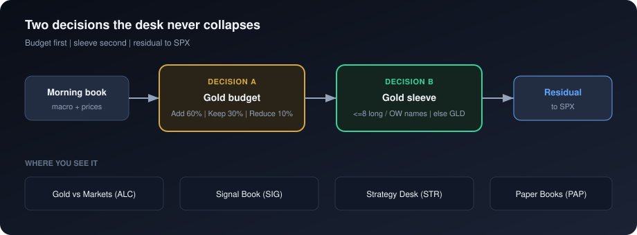
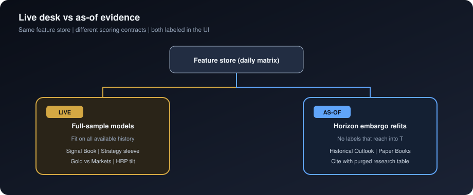
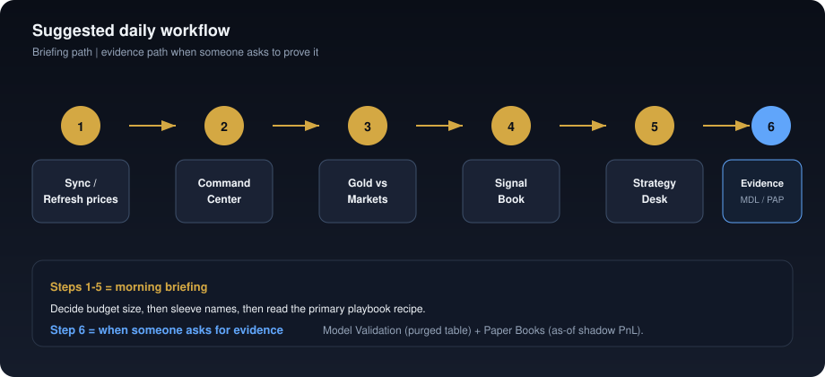

# PMIP — User & client guide

**Audience:** potential users, design partners, and peers who want to *use* the desk (not rebuild the models)  
**Product:** Precious Metals Macro Intelligence Platform (PMIP)  
**What this is:** a morning briefing and research terminal for gold and mining exposure  
**What this is not:** a broker, trading app, or promise of guaranteed returns

For the technical / modeling deep dive, see [guide-for-data-science-peers.md](guide-for-data-science-peers.md). Product requirements: [PRD.md](PRD.md).

---

## 1. In one minute

PMIP helps you answer two practical questions:

1. **Should my gold budget grow, stay, or shrink** versus stocks and the rest of a multi-asset book?
2. **Inside that gold budget**, which names look stronger — bullion or which miners / royalties — over the next week to roughly six months?

You get a ranked briefing, clear reasons, simulated paper books, and labels that say when a number is a **live desk signal** versus **historical evidence**. The software does **not** place trades.



---

## 2. Getting started

### Requirements
- A laptop with Python 3.11+ and Node.js 20+
- Optional: a free [FRED API key](https://fred.stlouisfed.org/docs/api/api_key.html) for better Treasury / real-yield data

### First-time setup

```bash
cp .env.example .env    # add FRED_API_KEY if you have one
make install
make init-db
make pipeline           # or use Run Pipeline in the app with a short preset
make dev
```

Open **http://localhost:8000**.

### Two important buttons

| Button | What it does |
| --- | --- |
| **Sync** | Reloads the last saved briefing from the database. Fast. |
| **Run pipeline** | Fetches prices, rebuilds features, (optionally) retrains models, refreshes paper books. Choose a **preset** so you are not always waiting hours. |

**Useful presets**

| Preset | When to use it |
| --- | --- |
| Refresh prices | Morning update of markets and regime |
| Rescore signals | New forecasts from models you already trained |
| Train short horizons | Retrain 1-week / 2-week / 1-month models on liquid names |
| Rebuild paper books | Refresh historical as-of scores and shadow PnL |
| Full pipeline | Everything — use when you have time (can take 1–3+ hours) |

If a screen is empty, use the **Run pipeline** button on that page.

---

## 3. The two decisions (read this once)

### Decision A — Gold budget (Gold vs Markets)

Ask: *Over the next ~two weeks, should gold get more of the book, less, or the same?*

Possible answers:

| Stance | Meaning in practice |
| --- | --- |
| **Add** | Raise the gold sleeve (paper books use **60%** of the book in the gold sleeve) |
| **Keep** | Leave the gold sleeve near **30%** |
| **Reduce** | Cut the gold sleeve toward **10%**; more rests in the S&P 500 |

The screen explains *why*: gold vs stocks/oil/copper, real yields, the dollar, and the current market “regime” label.

### Decision B — Gold sleeve (Signal Book)

Ask: *Given the gold budget I keep, which metals names look better than gold futures over this horizon?*

Each name gets:

- A probability it beats gold futures (**P(Gold)**)
- An expected price move and a simple “alpha” after a flat 1% hurdle
- A plain label: long / overweight / neutral / underweight / short

Paper books and Strategy Desk then put up to **eight** long or overweight names in the gold sleeve (equal weight). If none qualify, the sleeve parks in **GLD**.

---

## 4. Live signals vs historical evidence

You will see badges like **live** and **as-of**. They matter.



| Badge | Means | Use it for |
| --- | --- | --- |
| **live** | Today’s desk model trained on all available history | Morning briefing and ranked names |
| **as-of** | A careful historical rebuild that refuses to peek at future returns | Charts of the past and paper-book performance |

**Rule of thumb for clients:** use **live** to discuss *what the desk thinks today*. Use **as-of** / Model Validation / Paper Books when someone asks *“show me evidence, not a tip.”*

---

## 5. Workspace tour (how to use each screen)

### Command Center (CMD)
Your home screen. Gold stance snapshot, regime, top miner ideas, macro strip, short insights.

**How to use it:** start every session here. If insights mention central banks, remember that series is still **illustrative seed data** (see Risk).

### Strategy Desk (STR)
Ranked **playbooks** built from today’s stance, the live signal sleeve, regime, and paper results. Each playbook has an action, a gold budget %, the sleeve names, evidence bullets, and caveats.

**How to use it:** open the primary playbook and read the recipe. Treat it as a **research suggestion**, not an order ticket.

### Gold vs Markets (ALC)
Full write-up of Keep / Add / Reduce with comparison bars (stocks, oil, copper) and drivers (real yield, dollar, environment).

**How to use it:** decide the *size* of the gold allocation before you argue about individual miners. If real yield shows **estimated**, a FRED key was not available.

### Metals Book (MTL)
The instrument universe: what is priced, what has a model, and what industry instruments this free-data build cannot mark (for example some LME contracts or physical premiums).

**How to use it:** set expectations on coverage before a diligence conversation.

### Signal Book (SIG)
Table of forecasts by horizon tab: **5d · 10d · 1m · 3m · 6m**. Filter by tier, sort by alpha or probability, export CSV.

**How to use it:** pick a horizon that matches your review clock (e.g. 10d for a two-week IC note). Confirm the **live** path badge. Do not treat P(Gold) as “chance gold goes up” — it is the chance that name **beats gold futures** over that horizon.

### Model Validation (MDL)
**Cite this first** when someone asks if the research is careful. Top block: purged study results with costs. Below: operational model catalog (walk-forward diagnostics for deployed models).

**How to use it:** in a client or IC setting, screenshot or quote the purged table — not only Signal Book badges.

### Paper Books (PAP)
Five separate **$100,000** shadow accounts (one per horizon). Each rebalances only on its own clock, pays **10 basis points** when it trades, and is compared to holding gold or the S&P 500.

**How to use it:** ask “which rebalance clock looked least bad after costs?” Remember **Last stance** here is related to — but not identical to — Gold vs Markets.

### Portfolio (PTF)
Research weights from hierarchical risk parity blended with the live forecast tilt. Concentration stats (how top-heavy the book is).

**How to use it:** a second lens on sleeve construction — not live execution.

### Research Desk (RSH)
Regime history, standing hypotheses (“in this environment gold bias is usually…”), and macro series charts.

**How to use it:** narrative context for the stance, not a separate trading signal.

### Historical Outlook (HST)
Charts of how bullish probabilities evolved — built from **as-of** scores only.

**How to use it:** show path dependence and regime shifts without claiming a published live call history.

### How It Works (XPL)
Plain-language pipeline, data sources, and what each major number is allowed to mean.

**How to use it:** onboarding for new users and compliance-minded reviewers.

### Risk Monitor (RSK)
Geopolitical **proxy**, ETF flow **estimates**, central-bank **seed** tonnes, and agent score panels.

**How to use it:** context only. Trust the badges: proxy / estimate / seed are not live vendor feeds.

---

## 6. Horizons at a glance

| Tab | Trading days | Rough calendar |
| --- | ---: | --- |
| 5d | 5 | ~1 week |
| 10d | 10 | ~2 weeks (default for many views) |
| 1m | 20 | ~1 month |
| 3m | 63 | ~3 months |
| 6m | 126 | ~6 months |

Shorter horizons update more often in paper books; longer horizons need more history and are noisier on a short sample.

---

## 7. Where the data comes from (plain language)

| What you see | Where it comes from | What to tell a client |
| --- | --- | --- |
| Prices (gold, miners, SPX, oil…) | Yahoo Finance | Daily closes in a local database |
| Real yields / Treasuries | FRED if keyed; otherwise estimated | Prefer a FRED key for production-like demos |
| ETF “flows” | Estimated from market data | Labeled estimate — not official fund flow files |
| Central-bank buying | Built-in illustrative series | Seed data until a live WGC-style feed is wired |
| Geopolitical risk | Market proxy (volatility / oil) | Not a news-reading AI |
| Miner cost / production fields | Seed fundamentals | Illustrative until filings vendors are connected |

---

## 8. Suggested daily workflow



1. **Sync** or run **Refresh prices**.  
2. Open **Command Center** — note stance and regime.  
3. Open **Gold vs Markets** — confirm Add / Keep / Reduce and the reasons.  
4. Open **Signal Book** on the horizon you care about — scan longs / overweights.  
5. Open **Strategy Desk** — read the primary playbook recipe and caveats.  
6. If someone asks for evidence, open **Model Validation** and **Paper Books**.  
7. Export Signal Book CSV if you need to paste names into a memo.

Weekly or after big market moves: **Train short horizons** or **Rebuild paper books**. Periodically: **Full pipeline** + `make research` (for developers regenerating the citeable study).

---

## 9. How to talk about this with a client

**Good framing**
- “A research desk for gold budget and miner sleeve decisions.”
- “Live signals for today’s briefing; purged history and paper books for evidence.”
- “Explicit costs and baselines in the research note.”

**Avoid**
- “AI that predicts gold prices with X% accuracy.”
- “Live audited track record.”
- “Central banks bought X tonnes” without saying the series is seeded unless a live feed is connected.
- Treating Strategy Desk playbooks as trade tickets.

**Compliance-minded line:** PMIP is decision-support research software. It is not investment advice and does not execute orders.

---

## 10. Feature checklist (what the platform includes)

- [x] Keep / Add / Reduce gold budget with written drivers  
- [x] Multi-horizon signal book with export  
- [x] Strategy Desk playbooks (recipe, evidence, caveats)  
- [x] Selective pipeline presets + progress tracker  
- [x] Multi-horizon $100k paper books vs gold and SPX  
- [x] Purged research evidence on Model Validation  
- [x] As-of historical outlook charts  
- [x] Metals universe and coverage gaps  
- [x] Regime context and research hypotheses  
- [x] Risk proxies with honesty badges  
- [x] Live vs as-of labeling in the UI  

---

## 11. Limits to disclose early

- History in a typical install is short compared with multi-decade institutional backtests.
- Some tables are seeds or proxies (central banks, miner fundamentals, GPR, ETF flows).
- Paper books are simulations with simplified costs and rules.
- Live desk models and historical as-of scores answer different questions — both are shown on purpose.
- No login, broker link, or service-level agreement in the current v1 local product.

---

## 12. Getting help inside the product

- Every major workspace has a **method note** (“How this is produced”).  
- Tooltips explain individual metrics.  
- **How It Works** is the full guided tour.  
- API reference (for technical partners): http://localhost:8000/docs  

If you are evaluating PMIP as a design partner: start with Gold vs Markets → Signal Book → Paper Books, and ask the team to walk the purged research table on Model Validation. That sequence shows both the briefing and the evidence discipline.
